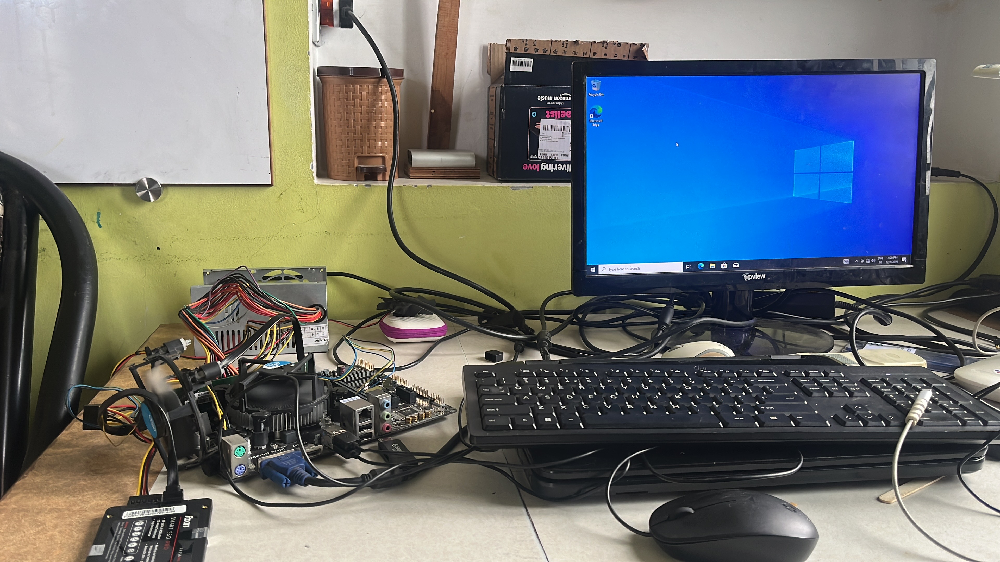

# Junkyard Home Server

<i>First boot: salvaged board, CPU, RAM and a repaired power supply, running open on the bench.</i>

**A dead PC pulled out of e-waste, repaired, and turned into the machine that now runs my house.**

It serves films to the television, reads my solar inverter every minute, filters the internet for the family,
and streams the CCTV cameras to my phone from anywhere in the country.

**Total spent: ₹0.** Every part was already broken, already owned, or already free.

---

## Why I built this

This did not start as a home-automation project. It started as a conflict over a laptop.

The family HP laptop had quietly become the house server. It held the photo library, it ran the media server
for the television, and it had started running a few other things besides. That meant it could never be
closed, never be carried to another room, and never be shut down — because the television would lose its
films and the cameras would go dark. A laptop that cannot be a laptop is a bad server *and* a bad laptop.

Meanwhile four separate problems had been accumulating, and each one had a commercial answer I did not want
to pay for:

| The problem | The product answer | What I did instead |
| --- | --- | --- |
| Films on the TV, and on phones away from home | A NAS, or a streaming subscription | Jellyfin on the junk PC |
| A solar inverter underperforming, and nobody could say why | The manufacturer's cloud app — owned by the installer, not by me | Read the inverter directly over Modbus |
| Watching the CCTV when away from the house | The DVR maker's cloud service, with its own account and its own privacy terms | Read the DVR's own snapshot endpoint and serve it over a private network |
| Blocking adult sites for a younger family member | A subscription filtering service | AdGuard Home as the house DNS |

Four problems, four subscriptions, four companies holding my data. Or: one dead computer, and the willingness
to read some documentation.

There was also a dead desktop sitting in the corner doing nothing. So the question became the one this
repository actually answers:

> **Given a pile of broken hardware and a budget of zero, how far can a house actually be automated?**

Further than I expected.

---

## First principles

Every decision here follows from four constraints. I am writing them down because the constraints produced
the architecture — not the other way round.

### 1. The budget is zero, so hardware is whatever already exists

This is the binding constraint and it shapes everything else. It rules out buying a NAS, a Raspberry Pi, a
mini PC, a managed switch, or a cloud subscription. What it does *not* rule out is **repair**, and repair is
usually a soldering iron and an afternoon rather than money.

It also inverts the normal design process. You do not choose software and then buy hardware to run it. You
measure the hardware you were given — 2 cores, 4 GB of RAM, one working memory slot, a tired cooler — and
then choose software that fits inside it. Almost every "obvious" modern answer (Docker, Immich, Nextcloud,
Home Assistant) is ruled out by 4 GB of RAM. What remains is small, boring, and fast.

### 2. The data already exists on the network — it just needs reading

This is the insight the whole project turns on.

My solar inverter already computes its own voltage, current and daily yield. My DVR already decodes its own
camera streams. Neither needs me to add a sensor. Both already answer on the local network. The manufacturers
simply prefer that I reach them through *their* cloud, with *their* app, under *their* account.

But a device on my own network, bought with my own money, answering on my own LAN, is mine to query. So:

- The inverter speaks **Modbus TCP**, an openly documented industrial protocol from 1979.
- The DVR speaks **HTTP**, with a snapshot endpoint any browser can fetch.

Neither vendor advertises this. Both do it. **Home automation on this budget is mostly protocol archaeology,
not hardware.**

### 3. Nothing may be exposed to the internet

A home server run by one person cannot be hardened like a real one. I am not going to keep up with patching a
public-facing service, and the DVR firmware in particular is old and unauditable.

So the rule is absolute: **no port forwarding, no public IP, no dynamic DNS, nothing listening on the open
internet.** Remote access happens over a private mesh network (Tailscale) where every device is
cryptographically identified. Every firewall rule on the server allows only the home subnet and the mesh
range, and nothing else.

This is not just caution. It is what makes the whole thing *possible* — once you accept you will never expose
a port, you stop needing a router you trust, a static IP, or a certificate.

### 4. It must survive without me

The machine is headless. No monitor, no keyboard, no mouse. It sits in a corner of a house with an unstable
mains supply and a network that intermittently drops.

So every failure mode I actually observed got a watchdog rather than a note in a file. The CPU runs hot, so a
governor watches the temperature and throttles. The network card silently stops passing traffic, so a
watchdog resets it and — if that fails — reboots the machine. Nothing here was designed in advance. Each one
exists because the thing it guards against *actually happened*, usually at an inconvenient hour.

---

## What it runs

| Service | What it does |
| --- | --- |
| **Jellyfin** | Films to the TV, phones and laptops, with hardware transcoding |
| **Solar dashboard** | Reads the inverter every minute; web dashboard, TV view, printable reports |
| **AdGuard Home** | House DNS: blocks ads, trackers and adult sites |
| **Camera viewer** | Live CCTV from the DVR, on demand only |
| **Tailscale** | Private mesh access from anywhere |
| **OpenSSH** | Remote administration from a Mac |

Plus three things with no user interface, which are arguably the most important parts:

- **CPU temperature governor** — keeps a poorly-cooled processor below 90 °C
- **Network watchdog** — recovers the network without human help
- **Health logger** — one sample a minute: temperature, memory, and whether each service is actually answering

---

## The hardware

Everything was recycled, repaired, or already owned.

| Component | Condition when found | After |
| --- | --- | --- |
| Gigabyte H110M-H motherboard | 6+ bent CPU socket pins | Straightened, works |
| Intel Core i3-6098P | Untested, pulled from scrap | 2 cores / 4 threads, stable |
| Mercury PSU | Swollen 450 V capacitor | Capacitor replaced, rails verified |
| 4 GB DDR4-2133 | Salvaged | Working — and the current bottleneck |
| 256 GB SSD | Spare | System drive |
| 320 GB laptop HDD | No partitions, presumed dead | **200 GB of family photos recovered** with open-source [TestDisk](https://www.cgsecurity.org/wiki/TestDisk) |
| Case, USB headers, cooler | Junkyard | Refitted and rewired |
| Old Wi-Fi router | Replaced, gathering dust | Now an access point |

### Honest limitations

I would rather state these than have someone discover them:

- **4 GB of RAM, and memory slot 2 is dead.** Both sticks work in slot 1, so it is the board, not the memory.
  The machine runs at roughly 50% memory use with everything going; it works, but there is no headroom. The
  fix is one 8 GB stick, not two 4 GB ones.
- **The CPU cooler is weak.** At one point it hit 94 °C under a 17 W load, which is absurd. Setting the BIOS
  fan to full speed brought idle down from ~68 °C to ~38 °C. It still wants fresh thermal paste.
- **The Ethernet link negotiates at 100 Mbps** on a gigabit card, and the network has dropped twice in the
  observed period. Prime suspect is the cable or the router port. The watchdog papers over it.
- **The salvaged 320 GB HDD reports 16 read errors.** It is unplugged and stored. It is not trusted with the
  only copy of anything, and recovering it properly needs a bigger disk than the server currently has.

---

## Documentation

The detail lives in separate documents so this page stays readable:

| Document | Contents |
| --- | --- |
| **[The rebuild](docs/01-hardware-rebuild.md)** | Socket pins, the PSU capacitor, BIOS recovery, data recovery |
| **[Windows 11 on unsupported hardware](docs/02-windows-on-old-hardware.md)** | Flyby11, and stripping Windows down to fit 4 GB |
| **[The network](docs/03-network.md)** | The old router as an access point, static addressing, a broadcast problem that cost a day |
| **[Remote access](docs/04-remote-access.md)** | Tailscale, Windows OpenSSH, and driving the server from a Mac |
| **[Reading the solar inverter](docs/05-solar-inverter.md)** | Modbus TCP, the register map, what the numbers revealed |
| **[Reading the CCTV](docs/06-cctv.md)** | The DVR's snapshot endpoint, and serving it without exposing the DVR |
| **[Keeping it alive](docs/07-keeping-it-alive.md)** | Thermal governor, network watchdog, health logging |
| **[File sharing](docs/08-file-sharing.md)** | Windows sharing over the private mesh |

And the working code, standard library only:

| File | What it is |
| --- | --- |
| **[CPU temperature governor](code/cpu-temperature-governor.py)** | Keeps a badly-cooled CPU under 90 °C by driving Windows' processor speed limit |
| **[Network watchdog](code/network-watchdog.py)** | Recovers the network when the adapter silently stops passing traffic |
| **[Solar inverter reader](code/read-solar-inverter.py)** | Modbus TCP client in ~30 lines — reads any inverter that speaks it |
| **[LG TV control](code/control-lg-tv.py)** | Puts the dashboard on the television from the server, with no cloud account |

See **[code/README.md](code/README.md)** for how each one works and how to install it.

---

## What it cost

| Item | Cost |
| --- | --- |
| Motherboard, CPU, RAM, case, cooler | ₹0 — e-waste |
| PSU capacitor | ₹0 — salvaged from another dead supply |
| SSD, HDD | ₹0 — already owned |
| Wi-Fi access point | ₹0 — previous router |
| Jellyfin, AdGuard Home, Tailscale, Python | ₹0 — free and open source |
| Windows 11 | Already licensed |
| **Total** | **₹0** |

Running cost is about 35–45 W, roughly ₹25 a month at local tariffs — and the solar panels cover daylight hours.

For comparison, the subscriptions this replaced would be somewhere north of ₹1,500 a month, before counting
the NAS I did not buy.

---

## What this is not

- **Not a polished product.** It is one house's setup, documented honestly, including the parts that are held
  together with watchdogs.
- **Not TrueNAS.** The original plan was to wipe Windows and install TrueNAS SCALE. It did not happen, for a
  good reason: TrueNAS wants 8 GB of RAM minimum and really wants ECC memory and multiple disks. This machine
  has 4 GB, one working memory slot and one SSD. Windows was already licensed and already installed, and
  every service I needed runs natively on it. **Choosing the boring option that fits the hardware beat the
  interesting option that does not.**
- **Not finished.** See the roadmap below.

---

## Roadmap

Ordered by how much each would actually help:

1. **One 8 GB DDR4 stick** in the working slot — the single biggest improvement available
2. **Fresh thermal paste** on the CPU, then raise the governor's ceiling
3. **A new Ethernet cable**, and a different port on the router
4. **Automated backups** (Kopia) — currently the weakest point in the whole design
5. **Uptime monitoring** (Uptime Kuma) — after the memory upgrade
6. **Proper disks**, and then finish recovering the old salvaged drive

---

## Lessons

**Measure before optimising.** I spent a long time tuning Wi-Fi channels before testing the actual line speed
and discovering the download ceiling was the internet plan, not the radio. Every band and every access point
gave the same ~40 Mbps. All that tuning changed nothing, because I had not established the baseline first.

**The constraint is the design.** Having 4 GB of RAM is what produced a stack of small standard-library
Python services instead of a pile of Docker containers. The result starts in seconds, survives reboots, and
has no dependency tree to rot. I would not have chosen it with more memory, and it is better than what I
would have chosen.

**Your devices already talk.** The inverter and the DVR both wanted me to use a vendor cloud app. Both answer
perfectly well on the local network, in documented protocols, to anyone who reads the manual.

**Design for the failures you observe, not the ones you imagine.** Every watchdog here exists because
something actually broke. The thermal governor exists because the CPU hit 94 °C. The network watchdog exists
because the network card silently died twice. I would never have predicted either.

**Repair is a budget.** A swollen capacitor is ₹10 and twenty minutes. Bent socket pins are tweezers and
patience. A surprising fraction of "dead" hardware is one cheap component away from working.

---

## License

MIT. Fork it, adapt it, document your own version.

---

*Built by a CS student with a soldering iron, a pile of e-waste and an objection to subscriptions.*
