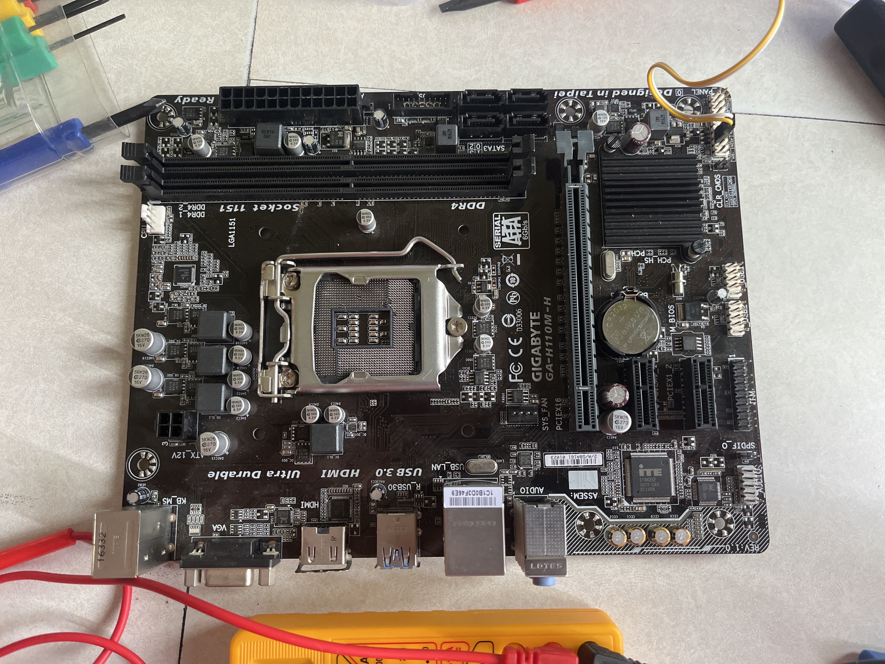
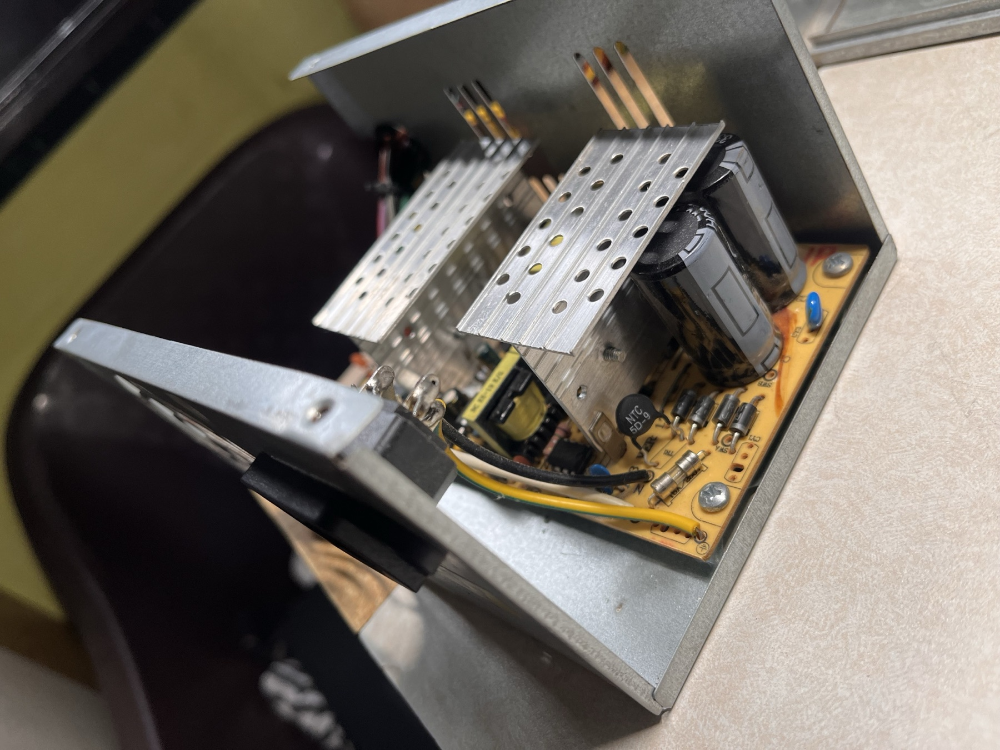
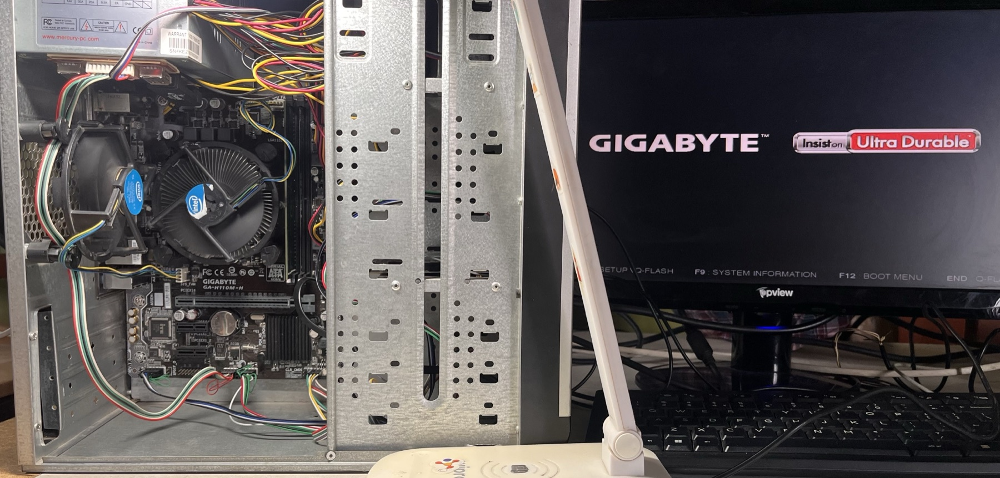

Turning a pile of e-waste into a machine that boots.

---

## What I started with

A non-functional PC and a box of scrap. Nothing had been tested; most of it was assumed dead.

| Part | Reported condition |
| --- | --- |
| Gigabyte H110M-H motherboard | "Dead" — bent CPU socket pins |
| Intel Core i3-6098P | Untested |
| Mercury PSU | Would not power on |
| 4 GB DDR4-2133 | Unknown |
| 320 GB laptop HDD | No partitions, "corrupted" |
| Case, headers, cooler | Broken USB ports |

---

## Motherboard: the socket pins

LGA1151 sockets have 1151 spring pins in the *socket*, not on the CPU. They bend if a CPU is dropped in
carelessly, and a single bent pin can disable a memory channel, a PCIe lane, or the whole board.

Six or more were visibly bent.

**Method:**
- Strong light and magnification. A phone camera zoomed in works well.
- A fine needle or sharp tweezers, working from the base of the pin outward.
- One pin at a time, comparing against neighbouring rows for the correct angle.
- A multimeter afterwards for continuity, and to check for shorts between adjacent pins.

**This is slow and it is unforgiving.** A snapped pin cannot be repaired. Patience is the entire technique.

> **Related:** memory slot 2 on this board never worked, and both sticks test fine in slot 1. That strongly
> suggests a socket pin serving Channel B is still not making contact — or was damaged beyond what I could
> see. If you pursue this, inspect the Channel B pins specifically. I chose to live with one slot.

---

## PSU: the capacitor

The primary smoothing capacitor had a domed top — the classic sign of a failed electrolytic.

### ⚠️ This is the genuinely dangerous step

A PSU's primary side holds **mains voltage at several hundred volts** on large capacitors, and **it holds it
after the unit is unplugged.** This can kill you. It is not like working on the low-voltage side.

**Non-negotiable:**
1. Unplug and wait several minutes.
2. **Verify with a multimeter** that the large capacitors read near zero volts. Do not assume — measure.
3. Discharge through a suitable resistor if they are still charged. Never short them with a screwdriver.
4. Work one-handed where practical, so no current path crosses your chest.
5. Keep the metal case grounded and insulated from you.

If any of that is unfamiliar, **do not do this**. A replacement PSU is cheaper than a hospital visit.

### The replacement

- Desoldered the failed capacitor, noting polarity (the stripe marks negative).
- Fitted a salvaged capacitor of the same capacitance and voltage rating. **Higher voltage rating is safe,
  higher capacitance is usually fine, lower of either is not.**
- Verified polarity twice before powering on — a reversed electrolytic vents violently.
- Tested each rail under no load with a multimeter: 12 V, 5 V, 3.3 V, and the −12 V and 5 VSB rails.
- Only then connected it to the board.

---

## CPU and cooling

- Cleaned old paste off the CPU and cooler with isopropyl alcohol.
- Fresh thermal paste, pea-sized, in the centre. Not spread — mounting pressure does that.
- Refitted the cooler, tightening in a cross pattern so pressure stays even.

> **In hindsight this was not done well enough.** The machine later hit 94 °C under a mere 17 W load, which
> is far beyond normal for this processor. Setting the BIOS fan profile to full speed dropped idle
> temperature from ~68 °C to ~38 °C, which rescued it — but the mount or the paste is still suspect and the
> job wants redoing. See [keeping it alive](07-keeping-it-alive.md) for the software that compensates.

**If you take one thing from this:** check your temperatures under load before declaring a build finished.
Idle temperature tells you almost nothing.

---

## BIOS recovery

The board would not POST reliably at first.

- Cleared CMOS with the jumper, and by removing the coin cell for several minutes.
- Reflashed the BIOS from the manufacturer's utility once it booted.

The BIOS on this board is still the factory 2016 release. **I deliberately have not updated it**: there is no
UPS, the local mains supply is unstable, and a power cut during a BIOS flash leaves a brick. The risk is not
worth a changelog I do not need.

---

## Assembly

- Front panel headers rewired (the F-panel pinout is in the board manual and is easy to get wrong).
- SATA and power cables routed for airflow rather than tidiness.
- The case's broken USB ports were bypassed with an external hub.

---

## Data recovery: 200 GB from a "dead" disk

The salvaged 320 GB laptop drive showed **no partitions** and was assumed to be a total loss.

It was not. A partition table is a few hundred bytes at the start of a disk. Losing it does not touch the
hundreds of gigabytes of files that follow — it only loses the *map*.

### Tools

- **[TestDisk](https://www.cgsecurity.org/wiki/TestDisk)** — finds and rebuilds lost partition tables
- **[PhotoRec](https://www.cgsecurity.org/wiki/PhotoRec)** — ignores the filesystem entirely and recovers
  files by recognising their internal signatures

Both are free, open source, and run from a USB stick.

### Method

1. **TestDisk first.** It scans cylinder by cylinder for boot sectors and partition remnants. If it finds
   them, you get your files back with their original names and folder structure — by far the better outcome.
2. **PhotoRec second**, for whatever TestDisk could not reach. It scans raw sectors for known file headers
   (JPEG, MP4, PDF, DOCX) and carves them out. You get the data but lose filenames and structure.

**Result: roughly 200 GB of family photos and videos recovered** that had been written off.

### What matters

- **Never write to the damaged disk.** Recover *to a different drive*, always. Writing to the source can
  destroy exactly what you are trying to recover.
- **Work from a copy if the drive is failing.** `ddrescue` can image a dying disk; recover from the image.
- **Stop if it clicks.** Repeated mechanical noise means a head problem. Every further minute of power risks
  more damage. That is a professional's job, in a cleanroom.

> **This drive now reports 16 read errors and is unplugged and stored.** It is not trusted with the only copy
> of anything. The recovered data needs to land on a bigger, healthy disk before this is truly finished.

---

**Next:** [Windows 11 on unsupported hardware →](02-windows-on-old-hardware.md)
